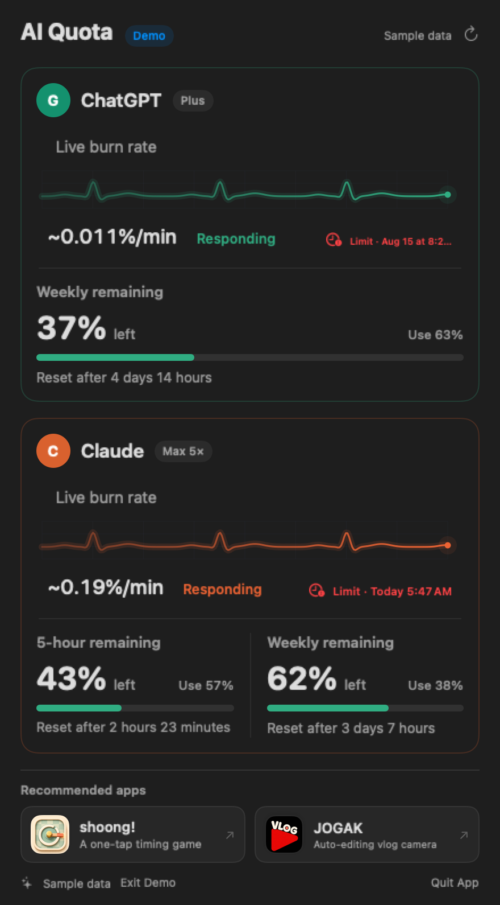

# AI Quota for macOS

**See your ChatGPT and Claude usage at a glance — right from the menu bar.**

[Download the latest release](../../releases/latest)

AI Quota is a lightweight macOS menu bar app for people who use ChatGPT/Codex and Claude/Claude Code throughout the day. It keeps each service separate, shows the quota windows available to your plan, and turns recent local activity into an easy-to-read live burn-rate estimate.

## Why AI Quota

- **One glance, two services** — separate ChatGPT and Claude cards in one compact panel.
- **Useful quota windows** — see 5-hour and weekly usage when the provider makes them available.
- **Live activity** — follow response activity through a continuously moving waveform.
- **Burn-rate estimates** — understand the recent pace in `%/min`, not raw request or token counts.
- **Reset and limit forecasts** — see when a quota resets and whether the current pace may reach it first.
- **Your preferred view** — switch the entire app between remaining and used percentages.
- **Menu bar summary** — check service-specific percentages without opening a full window.
- **Local-first design** — usage history and activity analysis stay on your Mac.

## Privacy by design

AI Quota does not operate an analytics or data-collection server. It reads usage-related metadata and local activity signals needed to display quota status, recent pace, and forecasts. Conversation content is not uploaded to the developer.

Read the full [Privacy Notice](PRIVACY.md).

## Requirements

- macOS 14 or later
- Apple silicon or Intel Mac when included in the selected release
- A ChatGPT/Codex and/or Claude/Claude Code account
- Codex or Claude Code installed and signed in for the corresponding local activity features

Available quota windows and update timing depend on the provider, account plan, and local tools installed on the Mac.

## How the connection works

AI Quota is not an official provider integration. It obtains quota metadata from local Codex or Claude Code state and, where available, provider usage interfaces using a session or credential already authenticated by the user. It does not ask for a provider password directly.

These interfaces and response formats are controlled by the providers and may change, be restricted, or stop working without notice. Apple notarization verifies the downloaded app package; it does not represent approval by OpenAI or Anthropic.

## Install

1. Download the latest notarized ZIP from [Releases](../../releases/latest).
2. Unzip it and move **AI Quota.app** to **Applications**.
3. Open AI Quota. Its icon appears in the menu bar.
4. Connect ChatGPT/Codex or Claude/Claude Code only when the app asks you to.

Updates are currently installed manually by replacing the existing app in Applications.

## Important notes

- Live burn rate and limit time are estimates, not provider billing records.
- Provider-side reporting can update in coarse increments or with a delay.
- Provider changes may temporarily or permanently affect compatibility.
- AI Quota is an independent app and is not affiliated with, endorsed by, or sponsored by OpenAI or Anthropic.
- ChatGPT, OpenAI, Codex, Claude, and Anthropic are trademarks of their respective owners.

## Support

See [Support](SUPPORT.md) or email [coolpisoo@gmail.com](mailto:coolpisoo@gmail.com). Never send passwords, login codes, access tokens, or complete conversation logs.

## About this repository

This repository intentionally contains only the downloadable app, release notes, screenshots, privacy information, and support materials. **The application source code is not published here.** GitHub automatically offers source archives for the small set of public documentation files in this repository; those archives do not contain the AI Quota application source.

Copyright © 2026 Coolpisoo. All rights reserved.
